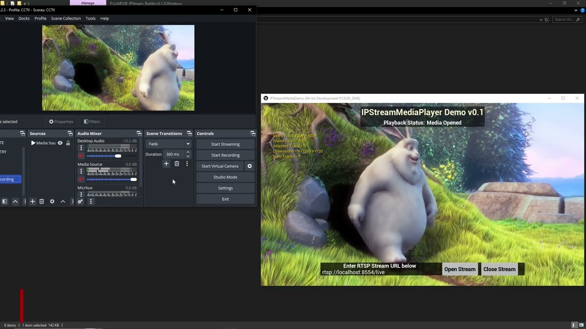

## Long time no see

The [last devlog](/devlogs/2026/10/12/ipstream_6.html) went up on 12 Oct. Between attending an expo, some personal things and a new [gameplay ability prototype](/projects/chrono-recall) that I built, I'm about two months behind, with an actual **beta release** 🎉 of this plugin somewhere in there. Catching up is gonna take two devlogs. This one's about the player itself, and the next one is about shipping it.

Quick recap. Back in [#4](/devlogs/2026/09/14/ipstream_4.html) I said the plan had three parts: prove FFmpeg works inside Unreal (the spike), set up a skeleton of the plugin, and wire the two together. [#6](/devlogs/2026/10/12/ipstream_6.html) ended with the skeleton done: a factory, a player and an event sink, `MediaOpened` and `MediaClosed` firing in Blueprint, and no FFmpeg anywhere. This devlog is the wiring part.

After a working player, the plan had a few more milestones lined up: move the colour conversion to the GPU, make the player survive things going wrong, get a packaged build and a latency number, and make a demo. Keep those in mind, they decide the order of things from here on.

## Stopping a thread that's stuck on the network

First, the spike's biggest problem. If you remember [#4](/devlogs/2026/09/14/ipstream_4.html), `GrabOneFrame()` froze the whole game for about a second per frame because FFmpeg was running on the game thread. So in the real player FFmpeg gets a thread of its own, a worker thread (an `FRunnable` in Unreal), which connects, reads and decodes while the game carries on.

The worker also outlives any one connection. If the stream drops, it waits a bit (1 s, then 2, 4 and 8 s) and connects again by itself, so a network hiccup doesn't kill the picture for good.

Starting the thread was the easy part. **Stopping it is the hard part.** Most of the time the worker is sitting inside FFmpeg's `av_read_frame`, blocked, waiting on the network. Nothing in Unreal can reach into that call and tell it to stop. And it has to stop every time you close the player or stop PIE, otherwise the editor just hangs.

This is where our old friend, FFmpeg's **interrupt callback** comes to our rescue. FFmpeg calls it while it waits, and if it returns 1, FFmpeg gives up. In the spike it only checked a timeout clock. In the player it also checks a **stop flag**, so `Close()` sets the flag, the callback is triggered, FFmpeg gives up, and then the player waits for (joins) the thread.

While researching how Unreal's own media players handle shutdown I found out that Electra player tears everything down in the background and doesn't wait for things to actually 'shut down'. That way was not ideal for this player because it unloads the FFmpeg DLLs on shutdown, so if a thread is still inside FFmpeg at that moment (pending destruction / join), that's a straight up crash.

So how long does that join take? Tested in **PIE**:

- **1.5 ms** when the worker is waiting in our own code (between reconnect attempts)
- **37 ms** median while streaming
- **65 ms** while connecting
- **92.8 ms** worst case

The worst case never went past 100 ms, but there was a huge gap between 1.5 ms and 92.8 ms, and I'd told myself that if joins go beyond 100 ms, I'd go back and look at other options (maybe the Electra method?). So I tried finding how the callback's polling worked. Luckily I found that FFmpeg checks it on a fixed timer, every 100 ms: `POLLING_TIME 100` in `libavformat/network.h` 🤓. This meant that 100 ms was the worst case, which was good enough for me.

By 22 Sep the worker could connect, decode and stop cleanly. What it couldn't do was show anything. Every decoded frame was counted and thrown away, and the only proof it worked was a log line every 250 frames. Then my days got busy for about three weeks (hence the apology at the top of #6), and in mid-October I picked it up again with the obvious next step: getting those frames onto the screen.

## Live video, and one still frame

In #6 I said we'd talk about media samples later. This is later 🙂. A sample is one decoded frame, wrapped in a shape Unreal's Media Framework understands. The player drops samples into a queue, and the engine takes it from there and puts them on a Media Texture.

In our case decoded frames go into Unreal's sample queue (`FMediaSamples`) as BGRA texture samples, and FFmpeg's `sws_scale` does the YUV-to-BGRA conversion on the CPU on the way in, same as the spike did.

Now which frame actually gets shown is also a separate question, and Unreal's default answer doesn't suit a live feed. By default the engine keeps its own playback clock and shows the frame whose timestamp matches it, which is what you want for a video file. For a live camera I'd rather show each frame the moment it arrives, so our player opts out by answering yes to a feature flag called `AlwaysPullNewestVideoFrame` (in Unreal's words, the engine then "will not gate video frame output with its own timing"). That's "latest frame wins", and it keeps latency low. The flag only works with Unreal's newer timing model, so that's the one our player uses.

All that effort and the first test showed... **one still frame** -\_-. It looked exactly like the spike's single frame from #4, just with a lot more code behind it.

The culprit was a layer I hadn't paid much attention to, `MediaPlayerFacade`. It sits between the Media Player you use in Blueprint and every player plugin, it's the same code that went through the factories to pick our player in #6, and it's the one keeping that playback clock. When you call *Play*, it checks the speed you asked for (the "rate") against the rates the player says it supports. The skeleton from #6 had placeholder answers there, and they said "none". So the facade quietly turned *Play* into rate 0, which means paused. At rate 0 it fetches one frame and stops. The fix: report rate 1.0 as supported. Lesson learned, **the facade runs the show**.

The annoying part is that I'd found the same kind of trap a few days earlier, just by reading the engine code. The engine picks which sample to show by checking which one covers the current moment. A sample with a **duration of 0** covers no time at all, so the engine never takes it, and nothing tells you. Rate 0 does the same thing from the other side: the stretch of time the engine looks at becomes empty. So now every sample's duration is always above 0, with fallbacks.

One more thing from that reading, and it ties back to the reconnects. A reconnect makes the camera's timestamps start again from near zero, which to the engine would look like going back in time. That newer timing model has a second number in its timestamps for exactly this, a "sequence index", basically a lap counter. So the player just adds 1 to it on every new connection.

After fixing the facade bugs the plane finally played live video from my IP camera (H.265, 720p, 25 fps), through a stock Media Player and Media Texture. Just for fun I also opened four streams at once and it looked fine, but I haven't measured anything there, so I'm not calling it multi-stream support yet.

_The same setup with OBS streaming Big Buck Bunny instead of my camera, for privacy reasons. Big Buck Bunny footage © 2008 Blender Foundation, [CC BY 3.0](https://creativecommons.org/licenses/by/3.0/){:target="\_blank"}._

### Was the thread worth it?

With a picture on screen, I could finally measure what the worker thread was built for. This is the number I'd been waiting for since the spike:

- Spike: game frozen for **0.999 s** on a good URL, **6.039 s** on a bad one.
- Player: *Open* blocks the game thread for **1.7 ms** (median), good URL or bad.

{:.img-center width="440"}

The first frame still takes about 1.4 s to arrive after *Open*, but that wait now happens on the worker while the game keeps running at ~120 fps. Opening again while a stream is already open takes 32 ms (median), and almost all of that is the join from the section above.

## What's next ?

By this time it was mid-October, and I realised that the weekends I'd planned for this project were all used up. The next devlog is about what came of that: a deadline, a packaged build that couldn't find DLLs sitting right next to it, and the first beta release.

This is the [Github repo](https://github.com/LifeisaRepo/UE_IPStream){:target="\_blank"} if you wish to follow along.

That's all for this one. Cheers! 🍻

